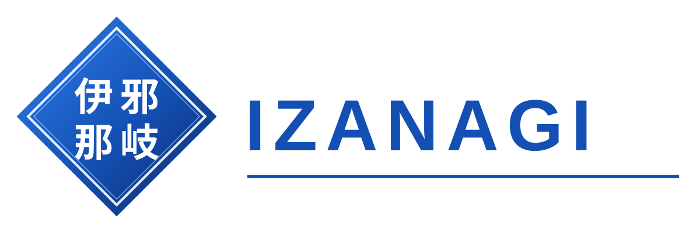

<p align="center">
  
</p>

# Izanagi

Plugin Claude Code qui pose le cadre de travail d'un projet, conduit ses jalons et applique ses règles par des hooks. Les réglages d'un projet et l'état de son flux en cours sont dans son dossier `.izanagi/`.

## Skills

- `/izanagi:init` démarre un projet de toute pile et pose son cadre. Il sait traiter deux cas :
  - Dans un dossier vide, il mène un entretien de départ, recommande une pile, lance le créateur officiel de cette pile, puis propose `gh repo create` et ne le lance que sur ton accord.
  - Dans un projet existant sans Izanagi, il détecte les composants et pose le cadre sans toucher au code.
- `/izanagi:jalon [phase]` conduit un jalon : cadrage, plan, tranches, revue de jalon, test, clôture. Chaque tranche passe une revue convergente (trois tours au plus, re-revue sur le seul diff des corrections). `/izanagi:jalon convergente` lance cette revue seule, pour une PR hors jalon.
- `/izanagi:task [issue ou description]` conduit un petit changement, de l'issue à la PR, sans spec ni plan : cadrage en cinq questions au plus, implémentation testée, revue, patch monté. Si le changement dépasse une tranche ou touche plusieurs coutures, il s'arrête au cadrage et propose un jalon.
- `/izanagi:fix [issue ou description du bug]` conduit un correctif : un diagnostic qui prouve la cause par un test de régression rouge, le correctif, la revue, la PR. Lancé pendant un jalon, il part de la branche du jalon et y revient. Les retours de test d'un jalon passent par lui.
- `/izanagi:grilling [sujet]` t'interroge par tours sur un plan ou une décision, jusqu'à ce que chaque point soit tranché. Le cadrage d'un jalon le lance aussi.
- `/izanagi:upgrade` met à jour le cadre d'un projet déjà posé. Il applique les migrations une à une sur une branche `task/izanagi-upgrade`, montre les écarts au gabarit, n'écrase un fichier modifié qu'avec ton accord et ouvre une PR.
- `/izanagi:status` liste les flux ouverts, d'après les branches `jalon/*`, `task/*` et `fix/*`, avec la phase, la tranche et le tour de revue de chacun.
- `/izanagi:doctor` contrôle le poste et le cadre : outils, hooks, réglages, version du cadre, contrat de vérification, cohérence de l'état avec git. Il propose la correction de chaque écart.

Les flux chargent huit autres skills du plugin, absents du menu des commandes : `brainstorming` écrit la spec, `domain-modeling` tient `CONTEXT.md`, `planning` écrit le plan en tranches, `task-loop` exécute les tâches d'une tranche, `tdd` fixe les règles de test, `review` conduit la revue convergente, `diagnosing` cherche la cause d'un bug et `merge-conflicts` résout un conflit. Cinq sous-agents font le travail délégué : `implementer`, `reviewer-standards`, `reviewer-spec`, `reviewer-security` et `diagnostician`. Les trois relecteurs sont en lecture seule. `reviewer-security` ne tourne qu'au niveau de risque élevé, contre la section « Sécurité » de la fiche du type d'application.

`init` pose `CLAUDE.md`, `AGENTS.md`, `.izanagi/config.env`, `docs/agents/*` (tracker, libellés de tri, domaine, vault, harnais), un squelette de `docs/CODING_STANDARDS.md`, le hook `.githooks/pre-push`, `scripts/check.sh` et la CI. Un projet à plusieurs composants reçoit aussi `scripts/dev.sh`, qui les lance ensemble.

Un projet posé a trois fichiers propres à Izanagi :

- `.izanagi/config.env` porte les réglages, une valeur par ligne (`clé=valeur`) : version du cadre, chemin de la spec, lieu des décisions, dossier des plans, branche principale, commande de vérification, commande et lieu du test manuel, taille d'une tranche, chemins sensibles, fichier de version, chemin du vault ou `non`, et une clé par hook.
- `.izanagi/state.env` porte l'état du flux de la branche courante : flux, nom, phase, tranche, tour de revue, niveau de risque. Il est versionné sur la branche du flux, et la branche principale n'en porte jamais. Seul `scripts/state.sh` du plugin l'écrit.
- `docs/agents/harness.md` décrit le harnais : composants, systèmes cibles, type d'application et couches de test.

Le journal d'un jalon, `.izanagi/journal/<plan>.md`, est versionné sur la branche du jalon. La clôture le supprime avec l'état, dans le dernier commit avant la fusion.

`AGENTS.md` donne à un autre agent de code la spec, la commande de vérification et les règles de relecture. Il ne décrit pas les flux d'Izanagi.

## Niveaux de risque

Une tranche, un petit changement ou un correctif porte un niveau de risque, qui règle sa revue et son test manuel :

| Niveau | Exemples | Revue | Test manuel |
|---|---|---|---|
| faible | documentation, renommage, configuration | un relecteur, un tour | non |
| normal | comportement nouveau | deux relecteurs, trois tours au plus | oui |
| élevé | données, sécurité, migration, API publique | trois relecteurs, Sécurité compris, trois tours au plus, puis tu relis le diff | oui |

Le plan d'un jalon donne le niveau de chaque tranche. `task` et `fix` en proposent un au départ. Tu peux le changer à tout moment.

La clé `chemins_sensibles` de `.izanagi/config.env` liste des motifs de chemins, séparés par des virgules (`db/migrations/*, src/auth/*`). Un diff qui touche un de ces chemins est de niveau élevé, quel que soit le niveau déclaré.

## Hooks

Le plugin installe trois hooks. Chacun sort sans rien faire hors d'un projet Izanagi.

- **Au démarrage d'une session**, le premier ajoute au contexte l'état du flux de la branche courante. Il avertit aussi quand le cadre du projet est en retard sur le plugin.
- **Avant un `git push`**, le deuxième refuse un push qui vise la branche principale, `git push --all` et `git push --mirror` compris. Un push de tag et une suppression de branche passent. C'est un garde-fou contre un push fait par habitude : une commande construite pour le tromper passe.
- **À l'arrêt de l'implémenteur**, le troisième relance la vérification du projet. Un échec renvoie l'implémenteur au travail, avec la fin de la sortie. Le hook laisse passer un implémenteur qui se déclare bloqué, et cesse de bloquer après deux refus.

Les deux derniers bloquent par défaut. Pour qu'un hook avertisse au lieu de bloquer, écris `hook_push=avertit` ou `hook_verification=avertit` dans `.izanagi/config.env`.

Comme la branche principale ne reçoit plus de push direct, un jalon passe par des PR du début à la fin : le cadrage et le plan sur une branche `jalon/<nom>-cadrage`, puis le jalon lui-même.

## Piles

Trois piles ont un gabarit complet : Rust, TypeScript avec Node (npm) et Python (uv). Pour chacune, `scripts/check.sh` lance l'installation depuis le verrou, le format, le lint et les tests, et la CI exécute `check.sh --host` sur chaque système cible.

Pour une autre pile (Go, Java, C#, Swift…), `init` pose une section `# À ÉCRIRE` et la remplit en suivant `references/verification-contract.md`, qui fixe ce que `check.sh` et la CI doivent faire. Le script `check-contract.sh` du plugin contrôle ce contrat.

`scripts/check.sh` accepte deux options :

- `--host` vérifie le système courant seulement. Le hook pre-push l'utilise. Si le système courant n'est pas une cible, `check.sh` le saute ; sous Windows, il vérifie alors la copie WSL quand `linux` est une cible.
- `--clean` vide le cache WSL du projet.

Sous Windows, quand `linux` est un système cible, `check.sh` copie l'arbre de travail dans `~/.cache/<projet_dossier>-wsl` et y lance la vérification.

## Prérequis

Izanagi n'a aucun prérequis de skill. Il lui faut :

- le CLI `gh`, connecté au compte qui porte le dépôt, et Git Bash sous Windows ;
- bash 4 ou plus récent. Le bash 3.2 livré avec macOS ne suffit pas aux scripts du plugin : installe un bash récent (`brew install bash`) ;
- les outils de la pile choisie (`cargo`, `node`, `uv`…). `init` donne la commande d'installation d'un outil absent et attend ton accord avant de la lancer.

### Skills optionnels

Quatre skills du plugin `mattpocock-skills` aident à certaines étapes. Un jalon les lance s'ils sont installés et fait sinon un geste de remplacement :

- `codebase-design` aide à choisir la forme d'une couture pendant le plan ;
- `prototype` répond à une question du cadrage par un essai exécutable ;
- `research` établit un fait sur un outil ou une bibliothèque ;
- `wizard` guide une étape que toi seul peux faire, comme créer un jeton ou un secret de CI.

`init` signale ceux qui manquent et propose de les installer :

```bash
claude plugin install mattpocock-skills
```

La clôture d'un jalon propose aussi `/retro`, si tu as un skill de ce nom.

Dans un projet Izanagi, les skills `izanagi:*` priment sur les skills de même rôle d'un autre plugin, Superpowers compris. Le `CLAUDE.md` posé le dit.

## Installation

```bash
claude plugin marketplace add Alextradus/izanagi
```

```bash
claude plugin install izanagi@izanagi
```

Depuis un clone local, remplace `Alextradus/izanagi` par le chemin du clone : Claude Code lit alors les fichiers en place, et `/reload-plugins` prend une modification en compte.

## Feuille de route

La 0.5 clôt le chantier que fixe `docs/specs/2026-11-12-izanagi-harness-design.md`. La 1.0 sortira après un projet mené de bout en bout avec cette version.

Restent sans version prévue : un template de PR, la release et le déploiement d'un projet, et des évals du plugin sur un projet témoin.

## Contribuer

Izanagi n'a pas de jalons. Chaque changement passe par une PR, relue par `/izanagi:jalon convergente`. La version suit semver dans `.claude-plugin/plugin.json`, avec un tag `vX.Y.Z` par version. Avant de pousser :

```bash
claude plugin validate .
```

```bash
bash tests/install.sh && bash tests/check-contract.sh && bash tests/skills.sh && bash tests/state.sh && bash tests/hooks.sh && bash tests/risk.sh && bash tests/tools.sh
```

`tests/skills.sh` contrôle la structure du plugin : les seize skills, les quatre sous-agents, les outils des relecteurs et l'absence de renvoi à un skill externe obligatoire. `tests/state.sh` teste `scripts/state.sh`, `tests/hooks.sh` les trois hooks, `tests/risk.sh` le calcul du niveau de risque, et `tests/tools.sh` les migrations, `status.sh` et `doctor.sh`. Ce dernier prend deux à trois minutes sous Windows.

Les skills et les sous-agents dérivent des skills de Matt Pocock et de Superpowers, tous deux sous licence MIT. `NOTICE` cite les deux sources.
