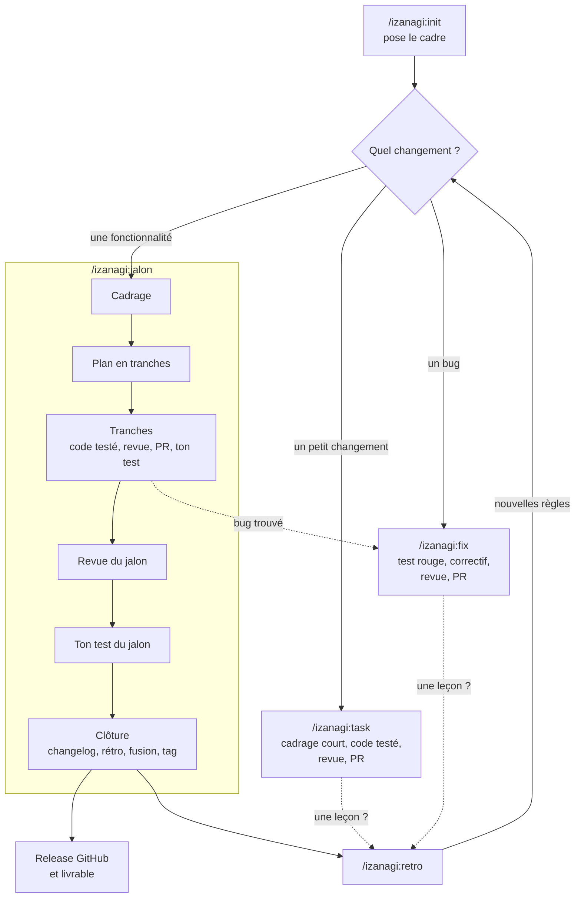

<p align="center">
  
</p>

# Izanagi

Plugin Claude Code qui pose le cadre de travail d'un projet, conduit chaque changement de l'idée à la PR fusionnée, et applique ses règles par des hooks.

Concrètement, Izanagi fait trois choses :

- **Il pose le cadre** d'un projet de toute pile : conventions, réglages, une vérification (`scripts/check.sh`), la CI, la release et les hooks.
- **Il conduit le travail** par trois flux : le jalon pour une fonctionnalité, `task` pour un petit changement, `fix` pour un bug. Chaque flux passe par des tests écrits d'abord, une revue par des relecteurs indépendants, une PR et ton test à la main.
- **Il apprend** : à la fin d'un flux, la rétrospective transforme ce qui a coûté (tours de revue, refus des hooks, reprises de ta part) en règles du projet, que tu acceptes une à une.

Tu restes aux commandes : rien ne fusionne, ne se publie ni ne s'ouvre sur GitHub sans ton accord.

## Installation

Il te faut le CLI `gh` connecté à ton compte, bash 4 ou plus (Git Bash sous Windows, `brew install bash` sous macOS), et les outils de ta pile. Le détail est dans [Démarrer](docs/guide/demarrer.md#prérequis).

```bash
claude plugin marketplace add Alextradus/izanagi
```

```bash
claude plugin install izanagi@izanagi
```

## Démarrer un projet

Dans le dossier du projet, vide ou non, lance :

```
/izanagi:init
```

- **Dans un dossier vide**, `init` te pose quelques questions (ce que tu construis, pour qui, sur quels systèmes), recommande une pile, lance son créateur officiel et pose le cadre avec un premier test par couche. Il propose ensuite de créer le dépôt GitHub.
- **Dans un projet existant**, il détecte les composants et pose le cadre sans toucher au code.

Ensuite, `/izanagi:doctor` contrôle que le poste et le cadre sont prêts. Le projet a maintenant :

- `.izanagi/config.env`, ses réglages : branche principale, vérification, test manuel, chemins sensibles… ;
- `scripts/check.sh`, la vérification : format, lint, puis les tests couche par couche ;
- la CI GitHub, la release, Dependabot et l'analyse de sécurité ;
- `CLAUDE.md`, `docs/CODING_STANDARDS.md` et `docs/agents/`, les conventions que l'agent lit.

## Le workflow de base



1. **Choisis le flux** d'après la taille du changement. Un changement qui tient dans une PR et se teste à un seul endroit est un `task`. Plusieurs PR, c'est un jalon. Un comportement cassé, c'est un `fix`.
2. **Le jalon** commence par un cadrage : Claude t'interroge jusqu'à ce que chaque décision soit tranchée, et les écrit dans la spec. Il écrit ensuite un plan en tranches, que tu valides. Chaque tranche est codée en TDD par un sous-agent, relue, ouverte en PR, puis testée par toi avant de fusionner dans la branche du jalon. Une revue de tout le jalon, ton test final, puis la clôture : changelog, rétrospective, fusion et tag, qui déclenche la release.
3. **`task` et `fix`** suivent le même chemin en plus court : une branche, quelques questions, le code testé (pour `fix`, un test qui montre le bug d'abord), la revue, la PR, ton test, la fusion.
4. **Chaque PR attend sa CI** : le flux ne te propose la fusion qu'une fois les checks verts.
5. **La rétrospective** clôt un jalon, et `task` et `fix` te la proposent quand ils ont coûté. Ses règles, une fois acceptées, sont lues par les flux suivants.

Le niveau de risque de chaque changement (faible, normal ou élevé) règle la profondeur de la revue et dit si tu testes à la main. Les hooks, eux, refusent un push sur la branche principale et te demandent confirmation avant un geste destructeur.

Le détail de chaque flux est dans [Les flux](docs/guide/flux.md).

## Les skills

| Commande | Ce qu'elle fait |
|---|---|
| `/izanagi:init` | pose le cadre d'un projet, dans un dossier vide ou un projet existant |
| `/izanagi:jalon [phase]` | conduit un jalon : cadrage, plan, tranches, revue de jalon, test, clôture. `/izanagi:jalon convergente` lance la seule revue, pour une PR hors flux |
| `/izanagi:task [issue]` | conduit un petit changement, de l'issue à la PR, sans spec ni plan. S'il est trop gros, il s'arrête et propose un jalon |
| `/izanagi:fix [issue]` | conduit un correctif : la cause prouvée par un test rouge, puis le correctif, la revue et la PR. Lancé pendant un jalon, il part de sa branche et y revient |
| `/izanagi:retro [branche]` | tire les leçons d'un flux (journal, revues, refus des hooks, historique git) et te propose une règle par leçon |
| `/izanagi:grilling [sujet]` | t'interroge par tours sur un plan ou une décision, jusqu'à ce que chaque point soit tranché |
| `/izanagi:contribuer [langage]` | propose au plugin, par une PR, les règles de langage que la rétrospective a jugées générales |
| `/izanagi:upgrade` | met à jour le cadre d'un projet déjà posé, par une PR |
| `/izanagi:status` | liste les flux ouverts, avec leur phase, leur tranche et leur tour de revue |
| `/izanagi:doctor` | contrôle le poste et le cadre, et propose la correction de chaque écart |

Les flux s'appuient aussi sur huit skills internes (spec, glossaire, plan, boucle des tâches, TDD, revue, diagnostic, conflits) et cinq sous-agents (un implémenteur, trois relecteurs en lecture seule, un diagnosticien). Ils sont décrits dans [Les flux](docs/guide/flux.md#les-skills-internes-et-les-sous-agents).

## Documentation

Le [guide](docs/guide/README.md) entre dans le détail :

- [Démarrer](docs/guide/demarrer.md) : prérequis, `init`, les fichiers posés, les piles, `upgrade`, `doctor` et `status` ;
- [Les flux](docs/guide/flux.md) : le jalon phase par phase, `task`, `fix`, la revue convergente, les niveaux de risque, la rétrospective ;
- [Tests](docs/guide/tests.md) : les couches de test, la double boucle, la mutation, les règles par langage ;
- [Garde-fous](docs/guide/garde-fous.md) : les hooks et la sécurité du projet ;
- [Release](docs/guide/release.md) : changelog, release, livrable et déploiement.

Les décisions qui fondent chaque comportement sont dans `docs/specs/`, et les plans de chaque version dans `docs/plans/`.

## Feuille de route

La 0.5 clôt le chantier que fixe `docs/specs/2026-11-12-izanagi-harness-design.md`. La 0.6 ajoute la sécurité et l'auto-amélioration, la 0.7 les couches de test, la couverture et la mutation, la 0.8 le changelog, la release, le livrable, le déploiement, Dependabot et l'analyse Semgrep. Chaque version a sa spec dans `docs/specs/`.

La 1.0 est la version où le harnais mène un projet de son cadrage jusqu'à une version publiée et livrée. Elle sort quand un projet témoin réel, posé en 0.8.0 ou plus sur la pile Rust, a mené avec le plugin un jalon complet, un `task`, un `fix` et une première release dont le livrable a tourné sur un système sans la toolchain. Quinze des dix-neuf issues de réception sont exigées, ainsi que la correction de #13 et #49 à #52. La liste, et la raison de chaque choix, est dans [`docs/specs/2026-11-26-izanagi-1.0-critere.md`](docs/specs/2026-11-26-izanagi-1.0-critere.md).

La 1.0 se reçoit sur Rust. TypeScript et Python gardent leur gabarit complet, testé par `tests/`, et leur réception en vrai passe en 1.x. Passent aussi en 1.x, sans retarder la 1.0 : des évals du plugin sur un projet témoin, une CI pour les tests d'Izanagi, les migrations de base de données, l'observabilité, la pile Go, entre autres.

## Contribuer

Izanagi n'a pas de jalons. Chaque changement passe par une PR, relue par `/izanagi:jalon convergente`. La version suit semver dans `.claude-plugin/plugin.json`, avec un tag `vX.Y.Z` par version. Depuis un clone local, `claude --plugin-dir <clone>` charge le plugin en place, et `/reload-plugins` prend une modification en compte. Avant de pousser :

```bash
claude plugin validate .
```

```bash
bash tests/install.sh && bash tests/check-contract.sh && bash tests/skills.sh && bash tests/state.sh && bash tests/hooks.sh && bash tests/risk.sh && bash tests/tools.sh
```

`tests/skills.sh` contrôle la structure du plugin : les dix-huit skills, les cinq sous-agents, les outils des relecteurs et l'absence de renvoi à un skill externe obligatoire. `tests/state.sh` teste `scripts/state.sh`, `tests/hooks.sh` les quatre hooks, `tests/risk.sh` le calcul du niveau de risque, et `tests/tools.sh` les migrations, `status.sh`, `doctor.sh`, `refus.sh`, `mutation.sh`, `historique.sh`, `attendre-ci.sh` et la recherche de secrets de `check.sh`. Ce dernier prend plus de dix minutes sous Windows.

Les skills et les sous-agents dérivent des skills de Matt Pocock et de Superpowers, tous deux sous licence MIT. `NOTICE` cite les deux sources.
