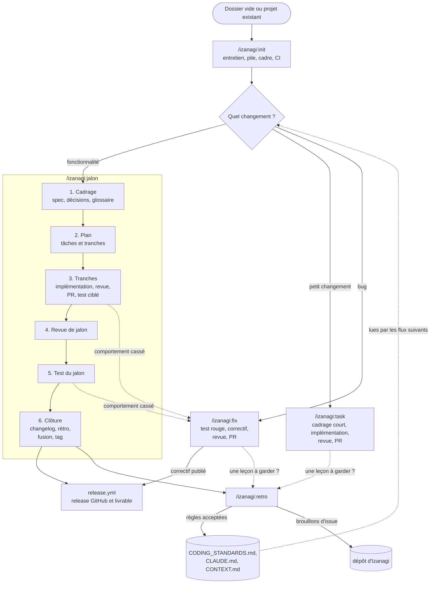

# Les flux

[Guide](README.md) · [Démarrer](demarrer.md) · [Les flux](flux.md) · [Tests](tests.md) · [Garde-fous](garde-fous.md) · [Release](release.md)

Un flux est un travail conduit par Izanagi sur une branche à lui, jusqu'à une PR fusionnée. Il y en a trois, et le choix dépend de la taille du changement :

| Ce que tu veux faire | Flux | Branche | Version |
|---|---|---|---|
| une fonctionnalité, plusieurs coutures, plusieurs PR | `/izanagi:jalon` | `jalon/<nom>`, et une `jalon/<nom>-tN` par tranche | la mineure monte, un tag à la clôture |
| un petit changement, une couture, une PR | `/izanagi:task` | `task/<nom>` | le patch monte, jamais de tag |
| un bug à corriger | `/izanagi:fix` | `fix/<nom>` | le patch monte hors jalon, un tag si tu publies |

Une **couture** est l'interface par laquelle un test prouve un comportement : une fonction publique, une route, la ligne de commande. Chaque couture a sa couche de test (voir [Tests](tests.md)).

Chaque flux tient son **état** dans `.izanagi/state.env`, sur sa branche : flux, nom, phase, tranche, tour de revue, niveau de risque. Le hook de démarrage le lit à l'ouverture de chaque session : une session rouverte sait où en est le travail sans rien relancer. `/izanagi:status` liste les flux ouverts.

## Vue d'ensemble

Chaque PR d'un flux passe la **revue convergente**, puis attend la fin de sa CI avant que le flux te propose la fusion. Tu donnes ton accord à chaque fusion, à chaque tag poussé et à chaque issue ouverte.

## Le jalon : `/izanagi:jalon`

Un jalon livre une fonctionnalité par **tranches**. Chaque tranche a sa branche, sa revue, sa PR vers la branche du jalon et ton test. La branche du jalon ne reçoit que des tranches relues et testées, puis part vers la branche principale en une seule PR.

`/izanagi:jalon` sans argument reconnaît la phase d'après git (spec, plan, branches, PR) et reprend là où le jalon en est. `/izanagi:jalon <phase>` force une phase.

### 1. Cadrage

Le cadrage fixe ce que le jalon construit. Sans spec, `brainstorming` l'écrit d'abord. Puis `grilling` t'interroge par tours : à chaque tour, toutes les questions qu'il peut poser sans deviner une réponse attendue, chacune avec la réponse qu'il recommande, jusqu'à ce que chaque point soit tranché. En même temps, `domain-modeling` écrit chaque terme dans `CONTEXT.md`. Chaque décision est datée et reportée dans la section de la spec qu'elle concerne.

Tout s'écrit sur une branche `jalon/<nom>-cadrage`, fusionnée par une PR, parce que la branche principale ne reçoit pas de push direct.

Fin : chaque question a sa réponse, tu as confirmé l'accord, et la spec est commitée.

### 2. Plan

`planning` écrit le plan dans `docs/plans/` : des tâches, chacune avec ses coutures, sa couche de test et ses signatures, regroupées en tranches. Le diff d'une tranche reste sous la taille d'une tranche (clé `taille_tranche`), la tranche se teste à la main et porte sa ligne `**Risque :**`. Une tranche qui change un comportement visible porte aussi sa ligne `**Acceptation :**`, le scénario de la double boucle.

Tu valides les coutures et le découpage. Le plan fusionne avec le cadrage, puis la branche `jalon/<nom>` naît avec son état.

### 3. Tranches

Pour chaque tranche, dans l'ordre du plan :

1. une branche `jalon/<nom>-tN` ;
2. `task-loop` exécute les tâches une à une : un sous-agent `implementer` par tâche, en TDD, puis une relecture de la tâche. Un hook relance la vérification à l'arrêt de l'implémenteur et le renvoie au travail si elle échoue ;
3. la revue convergente de la tranche, au niveau de risque du plan ;
4. la PR de la tranche vers la branche du jalon, avec les quatre titres du template (Quoi, Pourquoi, Vérification, Risque) ;
5. ton test ciblé, sauf au niveau faible ;
6. la fusion, avec ton accord, une fois la CI verte.

Le **journal** du jalon, `.izanagi/journal/<plan>.md`, garde la trace de chaque tâche, de chaque tour de revue, de chaque décision, de chaque constat écarté avec sa raison, et de chaque ligne `Correction :` quand tu reprends l'agent.

### 4. Revue de jalon

Les tranches ont déjà leur revue. Celle-ci cherche ce qu'elles ne voyaient pas une à une : les écarts à la spec sur tout le jalon et les défauts entre tranches. Elle prend le niveau le plus haut des tranches, normal au minimum, et reçoit le rapport de la passe de mutation. La PR du jalon vers la branche principale s'ouvre ensuite.

### 5. Test du jalon

Tu testes le jalon entier, d'abord les interactions entre tranches. Chaque retour suit sa nature :

- **un comportement cassé** passe par `/izanagi:fix`, qui part de la branche testée et y revient ;
- **une attente que le cadrage n'avait pas prévue** passe par une courte ronde de `grilling`, puis un implémenteur sur la branche testée.

Fin : tu valides le jalon.

### 6. Clôture

Tout se fait sur la branche du jalon, avant la fusion :

1. la mineure monte dans le fichier de version ;
2. la section de la version s'écrit dans `CHANGELOG.md`, dans la langue de `langue_publique`, et tu la relis ;
3. `CONTEXT.md` et le vault se mettent à jour ;
4. `/izanagi:retro` tire les leçons du jalon ;
5. l'état et le journal sont supprimés, en un seul commit ;
6. la PR fusionne, avec ton accord, une fois sa CI verte ;
7. le tag `vX.Y.Z` se pose sur le commit de fusion, et ne se pousse qu'avec ton accord. `release.yml` publie alors la release (voir [Release](release.md)).

Les branches du jalon sont ensuite supprimées.

## Le petit changement : `/izanagi:task`

`/izanagi:task [issue ou description]` conduit un changement qui tient dans une tranche et se teste à une seule couture, sans spec ni plan :

1. **Issue et branche.** Il lit l'issue, ou en propose une d'après ta description, puis crée `task/<nom>`.
2. **Cadrage.** Cinq questions au plus, pour quatre réponses : ce que le changement fait, la couture et sa couche, le critère de fin, le niveau de risque. Si le changement dépasse une tranche ou touche plusieurs coutures, il s'arrête, supprime sa branche et propose un jalon.
3. **Travail.** Un implémenteur, puis la vérification complète. Un changement de documentation ou de configuration au niveau faible se fait sans sous-agent.
4. **Revue**, au niveau retenu. Au niveau élevé, la passe de mutation tourne avant.
5. **PR et test.** Le patch monte, la PR s'ouvre avec `Closes #<n>`, et tu testes, sauf au niveau faible.
6. **Clôture.** Si la revue a pris deux tours ou plus, ou si un hook a refusé quelque chose, il te demande « une leçon à garder ? ». Puis la PR fusionne, une fois la CI verte.

`task` ne publie jamais : son changement part dans la prochaine version.

C'est aussi le flux d'une PR Dependabot majeure qui casse la vérification.

## Le correctif : `/izanagi:fix`

`/izanagi:fix [issue ou description du bug]` prouve la cause avant de corriger :

1. **Diagnostic.** Le sous-agent `diagnostician` cherche la cause et la prouve par un test de régression rouge, commité avant tout correctif. Si le comportement n'a jamais été cadré, ce n'est pas un bug : `fix` s'arrête et propose `/izanagi:task`.
2. **Correctif.** Un implémenteur fait passer le test, sans rien corriger d'autre.
3. **Revue, PR, test.** Comme pour `task`. Tu refais le geste qui montrait le bug.
4. **Clôture.** Il te demande « publier ce correctif ? ». Sur un oui, il écrit la section du patch dans `CHANGELOG.md`, puis pose le tag après la fusion.

Un correctif né d'un jalon garde l'état du jalon, avec une clé `correctif`. Sa branche part de la branche testée, sa PR y revient, et la version ne bouge pas.

## La revue convergente

`review` relit un diff sur deux axes, chacun avec son relecteur en lecture seule :

- **Standards** (`reviewer-standards`) : le code suit-il les règles écrites du projet et celles de son langage ?
- **Spec** (`reviewer-spec`) : le code fait-il ce que la spec demandait, ni moins ni plus, avec chaque test à la bonne couche ?

Au niveau élevé, un troisième relecteur, `reviewer-security`, cherche les failles que liste la fiche du type d'application.

Chaque constat porte une étiquette. Un **Important** se corrige, sur toutes ses occurrences du dépôt. Un **Nit** se corrige s'il tient en une ligne. Un **Préexistant** devient une issue. Un **Jugement** t'est présenté, et ta réponse s'applique. Chaque constat écarté est noté au journal avec sa raison. Les tours suivants ne relisent que le diff des corrections. La revue converge sur un tour sans Important, en trois tours au plus. Si le troisième en rend encore, elle s'arrête et te propose de revoir l'approche ou le découpage.

`/izanagi:jalon convergente` lance cette revue seule, pour une PR hors flux.

## Les niveaux de risque

Une tranche, un petit changement ou un correctif porte un niveau de risque, qui règle sa revue et son test manuel :

| Niveau | Exemples | Revue | Test manuel |
|---|---|---|---|
| faible | documentation, renommage, configuration | un relecteur, un tour ; un constat Important fait passer au niveau normal | non |
| normal | comportement nouveau | deux relecteurs, trois tours au plus | oui |
| élevé | données, sécurité, migration, API publique | trois relecteurs, Sécurité compris, et la passe de mutation ; trois tours au plus, puis tu relis le diff | oui |

Le plan d'un jalon donne le niveau de chaque tranche. `task` et `fix` en proposent un au départ. Tu peux le changer à tout moment. La revue de jalon prend le niveau le plus haut de ses tranches, normal au minimum.

La clé `chemins_sensibles` de `.izanagi/config.env` liste des motifs de chemins, séparés par des virgules (`db/migrations/*, src/auth/*`). Un diff qui touche un de ces chemins est de niveau élevé, quel que soit le niveau déclaré. `scripts/risk.sh` le calcule : le modèle ne monte pas le niveau de lui-même.

## L'attente de la CI

Juste après un push, GitHub n'a pas encore enregistré les checks du nouveau commit : `gh pr checks` répond « no checks reported », ce qui ne veut pas dire que la CI est verte. Avant de te proposer une fusion, chaque flux lance donc `scripts/attendre-ci.sh <PR>`. Le script attend que les checks apparaissent, puis qu'ils finissent, et relit la liste une dernière fois.

| Code | Sens | Suite |
|---|---|---|
| 0 | tous les checks passent | le flux te propose la fusion |
| 1 | un check échoue | pas de fusion : le flux montre les checks rouges, corrige, pousse et attend de nouveau |
| 3 | aucun check n'apparaît en trois minutes | le flux te le dit, et ne fusionne que si tu le demandes |
| 4 | des checks tournent encore après 30 minutes | idem |

## Apprendre de chaque flux

`/izanagi:retro [branche]` lit ce qu'un flux a coûté :

- le journal : tours de revue, décisions, constats écartés, retours de test ;
- les lignes `Correction :`, chacune une reprise de ta part ;
- les rapports de revue ;
- les refus des hooks (`.izanagi/refus.log`) ;
- l'historique git de la branche (`scripts/historique.sh`), qui compte les commits par type. Plus d'un quart de commits de suivi `chore(izanagi)` est une leçon sur le harnais, comme une série de reprises après une revue.

Une leçon est un constat qui revient, ou un coût que tu as nommé. Chacune devient une ligne proposée dans le bon fichier (`docs/CODING_STANDARDS.md`, `docs/standards/<langage>.md`, `CLAUDE.md`, `CONTEXT.md`, `chemins_sensibles`), écrite seulement si tu l'acceptes. Une leçon sur Izanagi lui-même devient un brouillon d'issue, sans nom ni chemin du projet, ouvert seulement sur ton accord.

La clôture d'un jalon lance `retro`. `task` et `fix` te demandent « une leçon à garder ? » quand la revue a pris plus d'un tour ou qu'un hook a refusé quelque chose.

`/izanagi:contribuer [langage]` propose au plugin, par une PR, les règles que `retro` a rangées sous `## À proposer au plugin`. Il les réécrit sans rien du projet, te montre le diff complet et ne pousse rien sans ton accord.

## Les skills internes et les sous-agents

Les flux chargent huit skills du plugin, absents du menu des commandes :

| Skill | Rôle |
|---|---|
| `brainstorming` | écrit la spec |
| `domain-modeling` | tient `CONTEXT.md`, le glossaire du domaine |
| `planning` | écrit le plan en tâches et en tranches |
| `task-loop` | exécute les tâches d'une tranche et tient le journal |
| `tdd` | fixe les règles de test, les couches et la double boucle |
| `review` | conduit la revue convergente |
| `diagnosing` | cherche la cause d'un bug |
| `merge-conflicts` | résout un conflit de fusion ou de rebase |

Cinq sous-agents font le travail délégué :

| Sous-agent | Rôle | Outils |
|---|---|---|
| `implementer` | écrit le code et les tests d'une tâche | lecture et écriture |
| `reviewer-standards` | relit le diff contre les règles du projet et du langage | lecture seule |
| `reviewer-spec` | relit le diff contre la spec et les couches de test | lecture seule |
| `reviewer-security` | cherche les failles du type d'application, au niveau élevé | lecture seule |
| `diagnostician` | prouve la cause d'un bug par un test rouge | lecture et écriture |

Dans un projet Izanagi, les skills `izanagi:*` priment sur les skills de même rôle d'un autre plugin, Superpowers compris.
